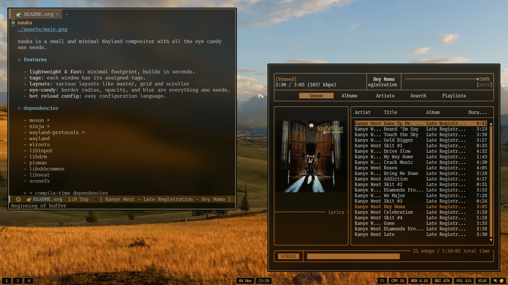

* nauka

nauka is a small and minimal Wayland compositor with all the eye candy one needs.

** features

- *lightweight & fast*: minimal footprint, builds in seconds.
- *tags*: each window has its assigned tags.
- *layouts*: various layouts like master, grid and scroller
- *ipc*: query toplevels, layers and outputs, or subscribe to events
- *eye-candy*: border radius, opacity, and blur are everything one needs.
- *animations*: fluid window animations with barely any overhead.
- *hot reload config*: easy configuration language.

** dependencies

- meson *
- ninja *
- wayland-protocols *
- wayland
- wlroots
- libinput
- libdrm
- pixman
- libxkbcommon
- libseat
- scenefx

> * compile-time dependencies

** installation

*** aur
latest version
#+begin_src bash
  yay -S nauka
#+end_src

git main version
#+begin_src bash
  yay -S nauka-git
#+end_src

*** building

#+begin_src bash
git clone https://github.com/shadowash8/nauka
cd nauka
meson setup build
ninja -C build
#+end_src

You may also choose to specify an init system.
Supported systems are systemd and dinit:

#+begin_src bash
  -Dinit=                # For no init files
         systemd         # Systemd only       [Default]
         dinit           # Dinit only
         systemd,dinit   # Systemd and dinit
#+end_src

** usage

#+begin_src bash
nauka [--session] [-s] [-c path]

-s            for startup script
--session     for automated dbus population
-c,--config   for specifying an alternative config file
#+end_src

** configuration
configuration is loaded from:
- =$XDG_CONFIG_HOME/nauka/nauka.conf=
- =$HOME/.config/nauka/nauka.conf=

if no configuration file is found, nauka will use its built-in defaults.
for an example configuration, see =default.conf= in the repository.

the configuration file supports hot reloading, so changes can be
applied without restarting nauka.

** ipc

nauka exposes a small line-based Unix-socket IPC. The socket lives at
=$XDG_RUNTIME_DIR/nauka-ipc.sock= by default; set =NAUKA_IPC_SOCKET= to
override it for both the compositor and the client.

#+begin_src bash
  nauka-ipc toplevels   # app_id<TAB>title, one per line
  nauka-ipc layers      # layer namespace, one per line
  nauka-ipc outputs     # output name, one per line
  nauka-ipc subscribe   # snapshot, then live events
#+end_src

=subscribe= prints a =subscribed= line, a snapshot of the current state,
then events as they happen:

#+begin_src text
  toplevel new <id> <tag> <app_id><TAB><title>
  toplevel title <id> <app_id><TAB><title>
  toplevel focus <id> <app_id><TAB><title>
  toplevel tag <id> <tag>
  toplevel state <id> <floating> <fullscreen> <sticky>
  toplevel destroy <id>
  tag <tag>
  layout <tag> <grid|master|scroller>
  output new <name>
  output destroy <name>
  layer new <id> <namespace> <output>
  layer destroy <id>
#+end_src

* nix flake
add nauka input to flake file
#+begin_src nix
  nauka = {
     url = "git+https://github.com/shadowash8/nauka";
     inputs.nixpkgs.follows = "nixpkgs";
   };
#+end_src

then add the package to system packages
#+begin_src nix
   inputs.nauka.packages.${pkgs.stdenv.hostPlatform.system}.default
#+end_src

optionally you can add nauka as a display manager session package
#+begin_src nix
   services.displayManager.sessionPackages = [
     inputs.nauka.packages.${pkgs.stdenv.hostPlatform.system}.default
   ];
#+end_src
